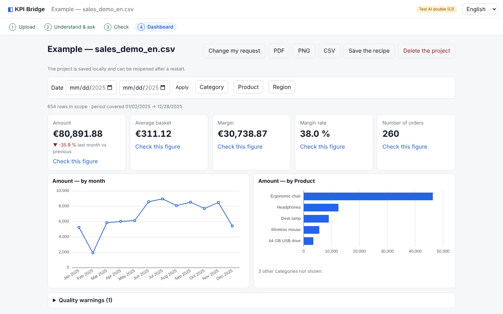
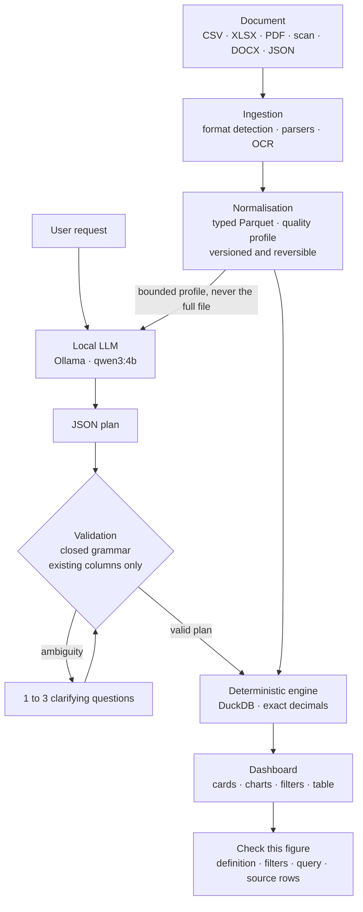
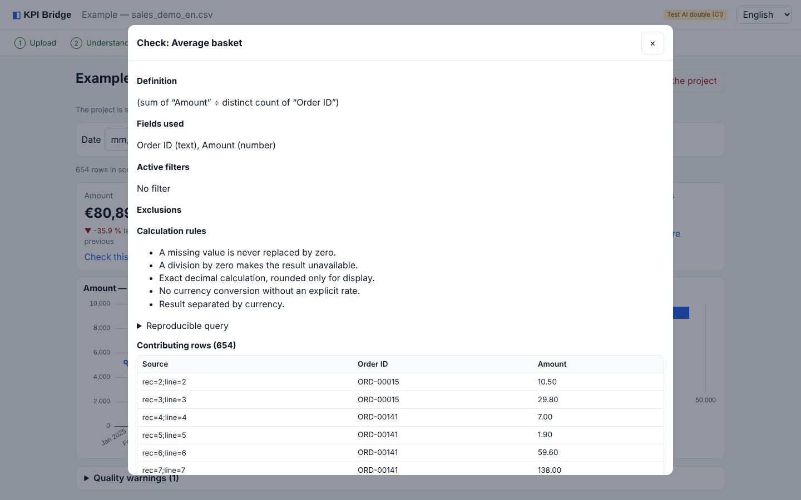
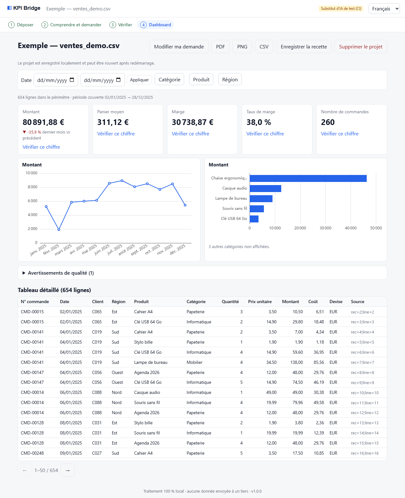
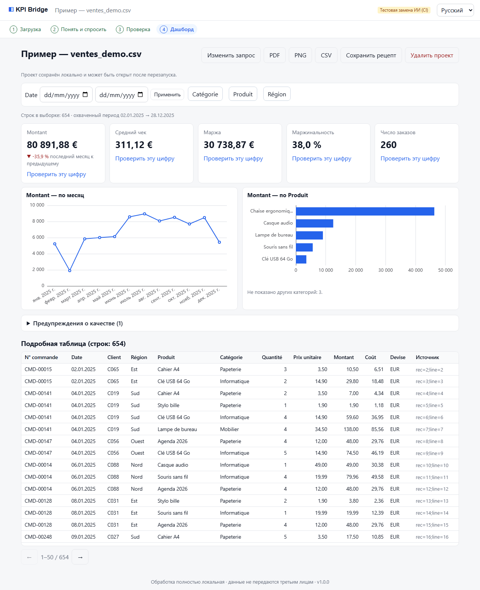
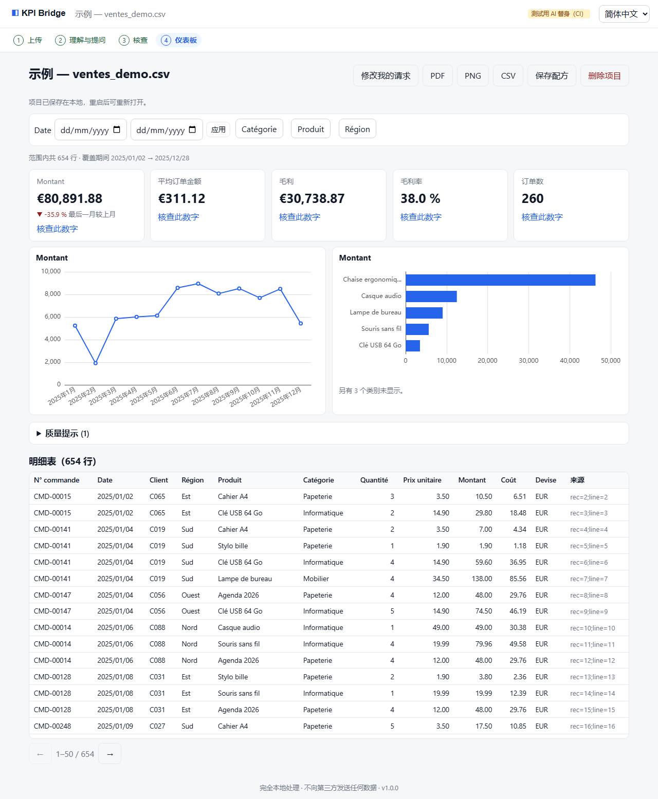

<div align="center">

# KPI Bridge

**Drop in a messy business document. Get a dashboard where every number can be verified.**

[](https://github.com/KevinJoseph-DataPortfolio/kpi-bridge/actions/workflows/ci.yml)
[](LICENSE)




<sub>Synthetic sample data. The interface ships in six languages (EN, FR, DE, ES, RU, ZH).</sub>

</div>

---

## What it does

1. **Drop a document**: CSV, XLSX, PDF (text or scanned), image, DOCX or JSON.
2. **KPI Bridge inspects it**: detects tables, headers, subtotals, repeated headers, date and number conventions, currencies.
3. **You ask in plain language**: *"Track monthly sales, the average basket and the top five products."*
4. **It asks only what matters** (1 to 3 questions per step): *"03/04/2026: 3 April or 4 March?"*, *VAT included or excluded?*, *count cancelled orders?*
5. **You get an interactive dashboard**: KPI cards, charts, filters, detailed table, PDF/PNG/CSV exports.
6. **Every figure is checkable**: *Check this figure* shows the definition, fields, filters, exclusions, the reproducible query and the source rows (page, cell or line).

No narrative summary, no invented number. Runs on one machine, for one person, with a local model.

## Why it exists

Most KPI mistakes do not come from charts. They come from silent assumptions:

- an average basket divided by **rows** instead of **orders**,
- a margin computed while some costs are **missing**,
- `03/04/2026` read in the wrong date order,
- VAT-inclusive and VAT-exclusive amounts **summed together**,
- cancelled or refunded orders counted as sales,
- a join that **duplicates** an amount without anyone noticing.

KPI Bridge is built around refusing those assumptions: **it asks, or it says "unavailable" and tells you why.**

## The one rule: the model proposes, the engine computes

A local LLM (Ollama, `qwen3:4b` by default) turns the request into a **JSON plan** written in a closed grammar.
It never produces a number, SQL or code. The plan is validated against the real columns, shown to the user in
plain language, and only then executed by a deterministic engine.



The full set of rules is in [`docs/KPI_RULES.md`](docs/KPI_RULES.md). A few examples, each covered by a test:

| Situation | Behaviour |
|---|---|
| Average basket over multi-line orders | `sum(amount) / distinct orders`: 250 / 3 orders, not 250 / 5 rows |
| Rate with different denominators | `Σ numerator / Σ denominator`: 15 / 1,010 = 1.485 %, not the 25.5 % an average of row rates would give |
| Missing value | Never turned into 0; ignored, counted and displayed. No value at all gives "unavailable" with a reason code |
| Division by zero | "Unavailable" (`division_by_zero`), never `NaN` or 0 |
| Mixed currencies | Results kept separate (EUR 125 / USD 50), no silent conversion |
| Join that would duplicate an amount | Blocked. Only many-to-one joins with a unique key and identical row counts and sums before and after |
| Ambiguous dates, VAT, cancellations | A question is asked, nothing is guessed |
| Duplicates, subtotals | Never silently deleted; flagged, excluded visibly and reversibly |
| Any correction | Creates a new dataset version, invalidates caches, never leaves a stale figure |

<div align="center">

</div>

## Engineering evidence

Measured and recorded in [`docs/TEST_REPORT.md`](docs/TEST_REPORT.md), including what could **not** be verified and why.

| Area | Result |
|---|---|
| Backend tests (unit, ingestion, KPI rules, API, security, real worker process, exports, i18n) | **55 / 55** |
| Browser tests (Playwright, test stand-in for the LLM, as in CI): 6 full journeys in 6 languages, mobile, no-session access | **10 / 10** |
| Browser tests with the **real local model** | **6 / 6** plans produced by the model, no fallback |
| Model evaluation (`qwen3:4b`, six languages) | **6 / 6** valid plans on the first attempt, 14 to 18 s each, all semantic checks passed |
| Static analysis | ruff, mypy (40 files), ESLint, `tsc`: clean |
| Supply chain | Hash-pinned lockfiles, `pip-audit` and `npm audit`: 0 known vulnerabilities, licence check (no AGPL/GPL-3/SSPL at runtime) |
| Performance, reference laptop (Ryzen, RTX 3050 6 GB, 15 GB RAM, Windows 11) | 50,000-row CSV imported in about 5 s, filter applied in about 0.2 s (median), first dashboard in 0.25 s, 172 MiB peak memory |

The test report also keeps the honest history: the first model schema scored 0 / 6, then 4 / 6, and how it was fixed
(constrained generation schema, guided example, bounded repair, a real global deadline).

## Quick start

| Platform | Command |
|---|---|
| Windows | Double-click `launch.cmd` |
| Linux / macOS | `./launch.sh` |
| Docker (reference path, see *Known limitations*) | `python scripts/kpictl.py launch --docker` (`--gpu` for NVIDIA) |

The first launch installs whatever is missing, idempotently and without administrator rights on Windows: a locked
Python environment, the compiled interface, Tesseract (OCR), Ollama and the `qwen3:4b` model (about 2.5 GiB), with
visible progress. It then starts the services and opens the browser on `http://127.0.0.1:8765` through a single-use
session link. Later launches reuse the installation (about 1 s). `launch.cmd --no-browser` prints the link instead
(valid for 5 minutes, usable once).

**Requirements**: Python 3.12 or later (tested on 3.14 under Windows 11; CI runs 3.12 and 3.13 on Ubuntu). Internet is
needed for the first installation only. No GPU is required to run the application: without a compatible GPU, Ollama
falls back to the CPU (slower). On Linux and macOS, Tesseract and Ollama are installed with the system commands shown
by `setup.sh`; without them the app still works, without OCR or AI (deterministic suggestions and the guided builder).

<details>
<summary><strong>Other commands</strong> (<code>kpi.cmd</code> on Windows, <code>./kpi.sh</code> elsewhere)</summary>

| Command | Effect |
|---|---|
| `kpi stop` | Stops the app and the worker (and Ollama if KPI Bridge started it) |
| `kpi status` | Service status |
| `kpi doctor` | Diagnostics: system, GPU, Python, OCR, Ollama, model, disk, health |
| `kpi update` | `git pull`, then reinstalls only what changed |
| `kpi backup` | Consistent backup of the data into `~/.kpi-bridge/backups/` |
| `kpi uninstall [--purge-tools] [--purge-data]` | Uninstalls. Data is deleted only with `--purge-data` and a confirmation |
| `setup.ps1` / `./setup.sh` | Installation only (`-NoAi`, `-NoOcr` / `--no-ai`, `--no-ocr`) |

</details>

## Using it

1. **Upload** one or more files (drag and drop), or *Try with an example* (synthetic data). Progress is real
   (upload, import, extraction, OCR, checks) and the task can be cancelled; it keeps running server-side if you reload.
2. **Understand and ask**: detected tables, size, period, preview, then *"What do you want to know from this document?"*
   Write freely in any of the six languages or pick suggestions built from the real columns.
3. **Check**: 1 to 3 useful questions if needed, then a readable plan to validate. The *Check the data* screen lets you
   choose the header row, fix types and conventions, exclude or restore rows, correct an OCR cell while seeing its
   source zone, and go back to a previous version.
4. **Dashboard**: 3 to 6 cards, 2 to 4 charts, period and category filters applied everywhere, a detailed table with
   provenance, *Check this figure*, PDF/PNG (snapshots) and CSV exports, a reusable recipe, and *Change my request*.

If the local AI fails (service absent, timeout, invalid plan after bounded repair), the app says so and opens the
guided builder, which uses exactly the same calculations. It is never presented as an interpretation.

<details>
<summary><strong>Supported formats and limits</strong></summary>

| Supported | Details |
|---|---|
| CSV, TSV, delimited TXT | Encodings (BOM, UTF-8/16, detection), separators `, ; TAB \|`, titles, totals, leading zeros kept |
| XLSX, XLS | Sheets, multiple tables, merged cells, subtotals. Formulas: cached value only, otherwise "unavailable" |
| Text PDF | Multi-page tables, repeated headers excluded, provenance by page and zone |
| Scanned PDF, PNG, JPG/JPEG | Local Tesseract OCR, column reconstruction, low-confidence cells flagged |
| DOCX | Tables; otherwise "label: number" values found in the text |
| JSON | Lists of objects (or an object containing one), flattened over 3 levels |

**Refused**: executables, archives (zip, 7z, rar...), macro files (xlsm, xlsb, docm...), password-protected files,
content that does not match the extension. No macro, formula, script, external link or PDF action is ever executed.
Text without digits or an unreadable image returns a clear message and a next action, never a fake KPI.

**Limits** (editable in `.env`): 25 MiB per file, 200,000 rows, 200 columns, 50 PDF pages, 20 OCR pages, 15 minutes
per task. They are enforced *while* processing (streamed reception, bounded reads). Beyond them: explicit refusal, or
page selection for PDFs.

</details>

<details>
<summary><strong>Storage, deletion, privacy</strong></summary>

Data lives in `~/.kpi-bridge/data` (`KPI_DATA_DIR` to change): SQLite (metadata), read-only sources, versioned Parquet,
OCR images. Projects are kept until deleted and can be reopened after a restart. *Delete the project* removes sources,
derived data, results, temporary exports and metadata (not a forensic erase; external backups are not affected). There
is no encryption at rest by the application: use disk encryption. Details in [`PRIVACY.md`](PRIVACY.md) and
[`SECURITY.md`](SECURITY.md).

</details>

<details>
<summary><strong>Troubleshooting</strong></summary>

- *"Local session required"*: run `launch.cmd` again (the link is single-use and lasts 5 minutes).
- AI unavailable: `kpi doctor`; check that Ollama answers and the model is present. The model is configurable with `KPI_OLLAMA_MODEL` in `.env`.
- OCR unavailable: `kpi doctor`; on Windows run `setup.ps1` again (or `launch.cmd`), otherwise install Tesseract.
- Port in use: change `KPI_PORT` in `.env`.
- Logs: `~/.kpi-bridge/data/logs/` (no document content, no secrets).
- PowerShell policy: `launch.cmd` runs no PowerShell script; if `setup.ps1` is blocked, use `launch.cmd`. No system policy is modified.
- Corporate proxy: local services are always contacted without a proxy.

</details>

## Development

```bash
python -m venv .venv && .venv/Scripts/pip install --require-hashes -r backend/requirements.lock -r backend/requirements-dev.lock
cd backend && python -m pytest                     # 55 tests, LLM replaced by an explicitly identified test double
ruff check backend scripts                         # lint (from the repository root)
cd backend && mypy kpibridge                       # types (the mypy config lives in backend/pyproject.toml)
cd frontend && npm ci && npm run lint && npm run build && npx playwright test
python scripts/eval_llm.py                         # evaluation of the real local model, 6 languages
python scripts/benchmark.py --ai                   # performance measurements
```

| Stack | |
|---|---|
| Backend | Python 3.12+, FastAPI, Pydantic v2, DuckDB, PyArrow (immutable Parquet per version), separate worker with a persistent SQLite job queue |
| Ingestion | pdfplumber, pypdfium2, Tesseract (pytesseract), openpyxl, xlrd, python-docx, defusedxml. No pandas: parsers emit text cells and typing is done by a dedicated normaliser (no implicit float conversion) |
| AI | Ollama, `qwen3:4b`, schema-constrained JSON output with bounded repair |
| Frontend | React, TypeScript, Vite, ECharts, i18next (shared locale files for UI and exports) |
| Exports | ReportLab with embedded Noto fonts (Cyrillic and Chinese covered), PNG rendered from page 1 of the PDF |
| Quality | pytest, Playwright, ruff, mypy, ESLint, pip-audit, npm audit, gitleaks, Trivy, licence check |

## Documentation

| Document | Content |
|---|---|
| [`docs/ARCHITECTURE.md`](docs/ARCHITECTURE.md) | Components, modules, canonical data model, API, technical decisions |
| [`docs/KPI_RULES.md`](docs/KPI_RULES.md) | The calculation grammar and every KPI rule |
| [`docs/TEST_REPORT.md`](docs/TEST_REPORT.md) | Test results, acceptance matrix, model evaluation, benchmarks, what is not verified |
| [`docs/STATUS.md`](docs/STATUS.md) | Project status |
| [`SECURITY.md`](SECURITY.md) | Threat model, protections and the tests that prove them |
| [`PRIVACY.md`](PRIVACY.md) | What stays on the machine (everything) |
| [`THIRD_PARTY_NOTICES.md`](THIRD_PARTY_NOTICES.md) | Third-party components and licences |

<details>
<summary><strong>More screenshots</strong></summary>

| Dashboard in French | Dashboard in Russian | Dashboard in Chinese |
|:--:|:--:|:--:|
|  |  |  |

The mobile layout is tested on a Pixel 7 profile (no horizontal scrolling):
[English](docs/screenshots/dashboard-en-mobile.png), [French](docs/screenshots/dashboard-fr-mobile.png),
[Russian](docs/screenshots/dashboard-ru-mobile.png), [Chinese](docs/screenshots/dashboard-zh-Hans-mobile.png).

</details>

## Known limitations

- **Docker Compose has not been executed** on the development machine (no Docker, no WSL, no administrator rights).
  The files are written and CI builds and scans the image, but the Compose journey (including the GPU profile) has not been run.
- **Linux and macOS** launchers have not been tested by hand; only the automated tests on Ubuntu (CI) cover them.
- `qwen3:4b` is a measured choice, not a guarantee: it succeeds on the reference requests in six languages but can be
  wrong on ambiguous ones. **The plan is always shown for validation.**
- PDF and PNG exports are snapshots. OCR does not read handwriting. Joins are limited to many-to-one.
- The model's data profile never leaves the machine; there is no cloud fallback by design.

## License

MIT, see [`LICENSE`](LICENSE). Third-party components: [`THIRD_PARTY_NOTICES.md`](THIRD_PARTY_NOTICES.md).
